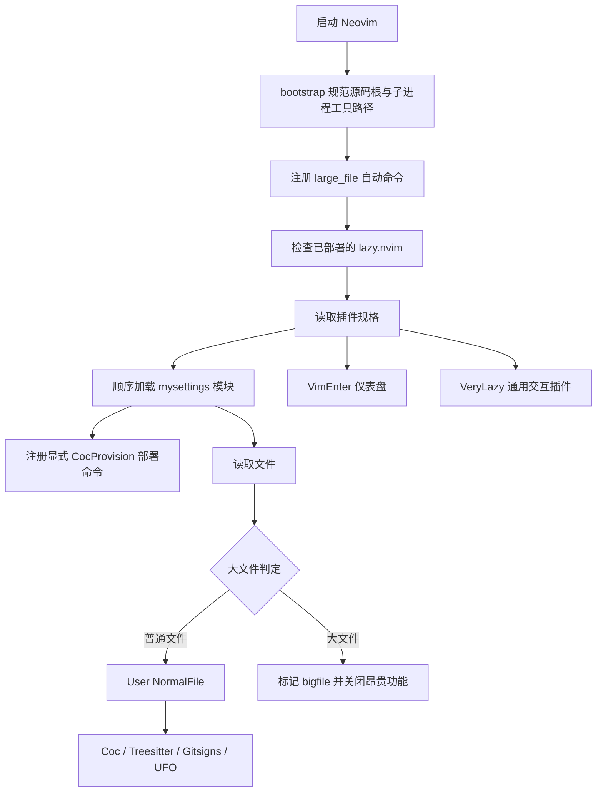
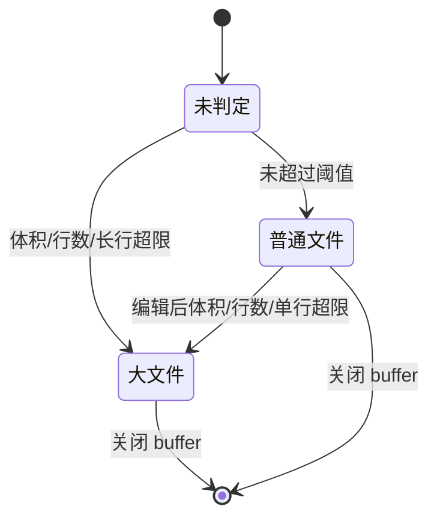
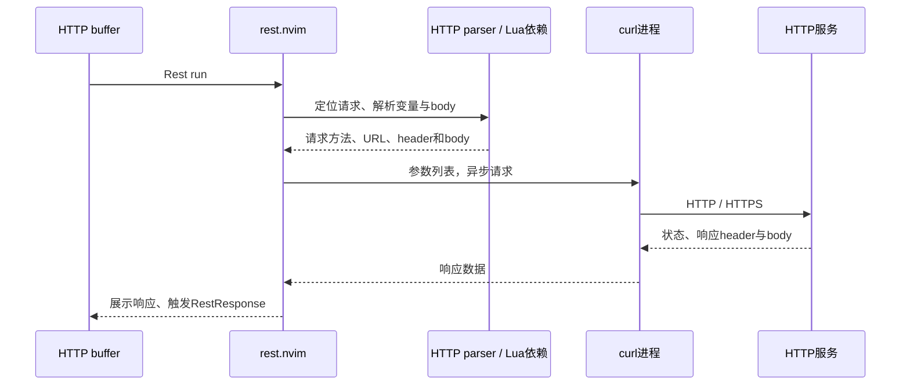

# Neovim 配置设计与维护

现状以本文和源码为准；用户已接受的目标、批次和验收契约见 [治理 SPEC](spec.md)，本轮修复、选版及验证见 [实施回执](implementation-2026-10-22.md)。各项实际状态见 [独立任务与依赖索引](tasks/README.md)，macOS实机及账号后的AI建议单列待验。

2026-10-22补充：当前完整教程见 [tutorial.md](tutorial.md)，[综合评审](configuration-review-2026-10-22.md)保存改造前缺陷；长行增长、Go服务、键位及搜索修复的最新证据见实施回执。

后续性能测量、插件保留依据及未安装候选见[下一阶段路线](next-stage-roadmap.md)。该文档是评估建议，不改变本设计中的当前实现或已接受SPEC。

当前项目配色已落在`mysettings/ngconsole.vim`：aipaas→tokyonight-night/dark，zagger_obsidian_gc→catppuccin-latte/light。项目规则支持可选background，先切明暗模式再应用主题，避免主题插件自动变体覆盖目标；使用项目根名称而非个人绝对路径。详情见[教程第15章](tutorial.md#15-不同项目使用不同主题)。

本文以当前仓库源码为依据，说明启动、插件、语言高亮、大文件保护和跨平台命令如何协作。配置同时面向 Windows 原生 Neovim（从 PowerShell、Git Bash 或 MSYS2 zsh 启动）和 macOS Neovim。Windows 的 `/c/Users/...` 是 Git Bash 表示法；Neovim 原生进程、编译器和 Python 接收的路径应使用其实际支持的 Windows 路径。

本文是仓库设计说明。日常操作参见 [BEST_PRACTICES.md](../BEST_PRACTICES.md)，部署参见 [WINDOWS-SETUP.md](../WINDOWS-SETUP.md)，持续追加的取舍见 [决策记录](decisions.md)，本轮证据见 [启动与 Coc TLS 故障](issues/2026-10-22-startup-coc-tls.md)，免费 AI 见 [选型与使用](ai-completion.md)。源码变化后，同步更新对应模块与验收边界。

## 1. 设计目标与责任边界

最新启动故障回执见 [Go 工具链下载造成首屏阻塞](issues/2026-10-22-go-toolchain-startup.md)：Coc 接管语言服务后，`go_compat.lua` 同时解除 vim-go 残留的 LSP 自动事件，避免已关闭的重复服务同步探测工作区。保留 vim-go 的明确构建、测试和格式化命令；Go 工具链选择仍遵循项目要求。`tests/go_startup_smoke.py` 覆盖此边界；此前的 GCC 测试不能替代它。

配置承担三件主要工作：为普通代码文件提供高亮、补全、Git 信息和导航；在读取大文件时提前避开昂贵的分析；把平台差异收敛到路径、工具发现和进程启动边界。

Python provider另有显式部署边界：`bootstrap.init()`在ftplugin前设置动态数据目录中的`python3_host_prog`，保留用户显式host；默认host及完成标记缺失时只提示部署，不扫描其他解释器或启动pip。`scripts/provision_python.py`使用本平台独立venv与固定依赖，重复执行可补齐中断的ensurepip并保留已有内容。项目Pyright解释器与编辑器provider相互独立。细节和当前验收见[provider启动故障](issues/2026-10-22-python-provider-startup.md)。

Treesitter 提供语法解析和结构高亮，Coc 提供语言服务、诊断、补全及格式化。两者独立：看到语法颜色不表示语言服务器已经安装；补全服务正常也不能证明对应 parser 存在。Git blame 依赖 Gitsigns 成功附加到 Git 跟踪的普通文件。

本仓库保留 Vimscript 设置层和 Lua 插件层，不要求将全部设置改写成 Lua。修改应进入实际负责该行为的模块，避免在多个加载入口重复定义。

## 2. 启动流程

入口为 [init.vim](../init.vim)，插件规格集中在 [lua/plugins.lua](../lua/plugins.lua)。

大文件自动命令必须先于插件加载注册。仅用 `BufReadPost` 加载所有分析插件，再关闭它们，会让第一次打开大文件仍支付初始化成本。这里用自定义的 `User NormalFile` 作为需要分析普通代码的插件入口。

普通启动的 Vimscript 模块依次为 `functions → basic → ui → maps → autocmds → ngconsole`。后加载的映射可能覆盖前面的映射，因此判断快捷键应查实际注册结果。

`init.vim` 还保留 `g:vscode` 分支，但当前仓库没有它引用的 `vscode/` 模块，不能将该分支视为已支持的运行方式。`mysettings/firenvim.vim` 也未进入当前模块加载列表。

## 3. 模块与数据位置

| 文件或目录 | 职责与维护入口 |
|---|---|
| [init.vim](../init.vim) | 引导lazy.nvim与启动顺序，注册显式部署和内置教程/面板入口 |
| [lua/bootstrap.lua](../lua/bootstrap.lua) | 解析源码根、固定锁文件、注册隔离工具链路径、执行构建引导 |
| [lua/plugins.lua](../lua/plugins.lua) | 插件依赖、加载条件、插件设置和 which-key 注册 |
| [lua/large_file.lua](../lua/large_file.lua) | 文件大小判定、buffer 标记、插件解除附加、窗口设置恢复 |
| [lua/platform.lua](../lua/platform.lua) | 主目录、可执行文件发现、终端启动、编译与运行、系统打开文件 |
| [lua/ai.lua](../lua/ai.lua) | Copilot 内嵌服务、代码类型与独立接受键 |
| [lua/coc_setup.lua](../lua/coc_setup.lua) / [coc-extensions.json](../coc-extensions.json) | 显式扩展部署入口与固定版本清单 |
| [scripts/deploy.py](../scripts/deploy.py) | 显式安装锁定 lazy.nvim、复制迁移 Coc 状态并保留源目录 |
| [mysettings/functions.vim](../mysettings/functions.vim) | 为已有 Vimscript 函数保留入口，并委托平台模块 |
| [mysettings/basic.vim](../mysettings/basic.vim) | 编辑器基础选项、缩进、窗口与终端基础映射 |
| [mysettings/maps.vim](../mysettings/maps.vim) | 编辑、Coc、Git、搜索与导航映射 |
| [mysettings/autocmds.vim](../mysettings/autocmds.vim) | 文件类型别名、终端插入模式、复制高亮与窗口事件 |
| [mysettings/ui.vim](../mysettings/ui.vim) | TUI/GUI 高亮、透明度、字体和 Neovide 设置 |
| [mysettings/ngconsole.vim](../mysettings/ngconsole.vim) / [lua/project_theme.lua](../lua/project_theme.lua) | 保留TrySwitchTheme入口，按活跃项目根选择主题 |
| [lua/languages.lua](../lua/languages.lua) / [scripts/provision_languages.py](../scripts/provision_languages.py) | 本平台固定语言工具的显式部署、路径发现与缺失诊断 |
| [lua/parser_setup.lua](../lua/parser_setup.lua) / [lua/neorg_setup.lua](../lua/neorg_setup.lua) | 普通语言与Neorg parser部署，编辑启动不安装 |
| [lua/search.lua](../lua/search.lua) / [lua/command_palette.lua](../lua/command_palette.lua) | 扫描策略、原生库诊断、命令发现和频率数据 |
| [coc-settings.json](../coc-settings.json) | Coc 和扩展的静态设置 |
| [my_snippets/](../my_snippets/) | 历史 Java、JavaScript、Vim 片段文件 |
| [lazy-lock.json](../lazy-lock.json) | 插件提交版本锁定，跨平台共享 |
| [scripts/bootstrap_rocks.py](../scripts/bootstrap_rocks.py) | Lua/LuaRocks 构建引导，供 rest.nvim 依赖安装使用 |

源码真实位置由 `g:nvim_config_root` 保存，入口通常位于 `stdpath('config')`；插件通常位于 `stdpath('data')/lazy`；构建产物、依赖环境和下载缓存归入数据目录。不要把某台机器的用户目录、临时目录、DLL 或编译结果提交为跨平台配置。parser 和本地模块应在目标操作系统上重新安装，不能直接复制 Windows 的 DLL 到 macOS。

主题按活跃普通文件的项目根识别：Git/worktree优先，其次workspace/package标记，最后cwd；BufEnter/DirChanged更新，特殊buffer保留最近主题，同目标不重复应用。可用 `g:nvim_project_themes` 规则配置绝对根、便携后缀及monorepo子目录；默认_oem→onelight、_bug→everforest，其余catppuccin-latte。完整colorscheme仍为进程级。GUI字体由宿主设置，终端字体由终端负责。

Windows 工具发现会还原无附加参数的 Scoop shim 指向的真实程序，优先加入真实 GCC 目录，避免 MSYS DLL 覆盖编译器依赖；只修改 Neovim 子进程 PATH。启动阶段不运行编译器探测，目标检查留在显式构建脚本。Python 在使用时按实际版本选择 3.9+，跳过 zsh 中可能仍存在的 Python 2.7。

Coc 数据固定为 `stdpath('data')/coc`，配置固定为源码根。Windows 子进程 HOME 规范为 USERPROFILE，XDG_CONFIG_HOME 规范为源码根的父目录，保证原生工具及 Copilot 的账号位置不按 shell 分裂。旧 Coc 状态通过部署脚本复制，不在启动时迁移。此前仅统一 HOME 的设计遗漏了 Coc 对 XDG_CONFIG_HOME 的优先分支，已在故障与决策记录更正。

## 4. 插件与加载边界

下表列出主要加载入口和依赖。版本以锁文件为准，表中事件应随 `plugins.lua` 一起维护。

| 入口 | 插件 | 主要依赖或作用 |
|---|---|---|
| `VimEnter` | lualine.nvim | 主题确定后初始化一次；状态栏、buffer 与 tab 展示 |
| colorscheme 请求 | catppuccin、onedarkpro、forest-night、tokyonight | 主题资源 |
| 空参数启动的 `VimEnter` / `:Alpha` | alpha-nvim | devicons；打开文件时不加载首页 |
| `User NormalFile` | gitsigns.nvim | Git；行号标记、行尾 blame、当前行 blame |
| `User NormalFile` | nvim-ufo | promise-async；Treesitter/indent 折叠 |
| `User NormalFile` | coc.nvim | Node.js；Vista 使用 Coc 符号 |
| `User NormalFile` | nvim-treesitter | IBL、treesitter-context、nvim-ts-autotag |
| `User NormalFile` | nvim-ts-context-commentstring | 按语法节点选择注释样式 |
| `VeryLazy` | vim-fugitive | Git 状态、提交、拉取与推送命令 |
| `:Legendary` / `:CommandPalette` | 本地command_palette模块 | Telescope命令发现；JSON保存次数与最近时间，旧SQLite显式导入 |
| `VeryLazy` | nvim-surround、which-key.nvim | 包围符编辑与快捷键提示 |
| `VeryLazy` | Comment.nvim | 集成 context-commentstring |
| `:Telescope` / 搜索命令 | telescope.nvim | ripgrep、fzf-native（`make` 显式构建）；SearchHealth诊断 |
| `VeryLazy` | vim-sneak | 双字符跳转 |
| `FileType http` | rest.nvim | HTTP parser、Lua rocks、curl；详见 HTTP 章节 |
| `FileType go` | vim-go | Go 工具命令；插件自己的 gopls 和代码补全已关闭 |
| `FileType norg` / `:Neorg` | neorg | 本平台parser显式部署；传递依赖按需加载，缺失parser显示指引 |
| `:NvimTreeFindFileToggle` | nvim-tree.lua | 文件树 |
| `:Tutor zh` / `:Tutor en` | 宿主内置Tutor | 独立练习副本和位置，不写宿主教材 |
| 按需 | plenary.nvim、nvim-web-devicons | 公共 Lua 工具与图标资源 |

`VeryLazy` 插件仍可能在大文件会话中加载。大文件保护重点避开逐 buffer 的语法解析、补全、诊断、Git 附加和折叠分析，并没有将所有交互界面插件全部卸载。

## 5. 高亮、语言服务与 Git

### 5.1 Treesitter

当前使用 `nvim-treesitter` 的 `master` 分支及锁定提交，以保留 `nvim-treesitter.configs` API，与 Neovim 0.10 系列配置保持一致。不要只把分支改成新架构分支而保留旧 `setup` 调用。

`lua/parser_setup.lua` 部署清单的parser为：

`c lua go python css scss typescript tsx html http javascript jsdoc json vue`

JavaScript/JSX使用javascript，TypeScript使用typescript，TSX使用tsx；Vue2/3使用vue及内嵌HTML/CSS/JavaScript parser，Go/Python各使用同名parser。日常 `ensure_installed={}`、`auto_install=false`；`:ParserInstall`调用锁定版同步安装API只补缺失并验证可加载，不使用会逐项询问重装的TSInstallSync命令。

高亮回调会检查大文件状态。缩进也由 Treesitter 提供，但 JavaScript 已排除。安装需要 C 编译器以及下载/解包工具；成功下载插件不等于 parser 已经编译成功。

### 5.2 Coc

`coc-extensions.json` 固定17项扩展，包括原14项及coc-pyright、coc-go、@yaegassy/coc-volar；Tabnine列入retired且不再部署。`g:coc_global_extensions=[]`避免编辑启动安装，`:CocProvision`为显式扩展入口。

Go使用托管gopls，Python使用Pyright及项目.venv，Lua使用显式部署的官方LuaLS，Vue使用兼容2.6/2.7/3的固定Volar/TS hybrid组合。工具路径由stdpath(data)生成，Rust/Svelte/snippets等保留设置不代表扩展已安装。各语言真实定义、补全、诊断、引用和重命名的能力矩阵与命令见 [语言服务](language-services.md)。

### 5.3 Git blame

Gitsigns 在普通文件事件后加载，并在 `on_attach` 为当前 buffer 建立 blame 映射。当前行尾 blame 默认开启，延迟为 1000ms。文件必须位于可访问的 Git 仓库内，且能取得 Git 历史；未跟踪文件、仓库外文件和大文件不能按普通已提交文件验收。

定位时依次检查 `:LargeFileInfo`、`:Gitsigns debug_messages`、`:verbose nmap <Space>gb`，再从同一终端运行 `git status` 与 `git blame -- <文件>`。插件表里出现 Gitsigns，只能证明已配置，不能代替附加状态检查。

## 6. 大文件保护的状态与代价

实现位于 [lua/large_file.lua](../lua/large_file.lua)。任一条件满足即触发：

- 文件体积大于 1 MiB。
- 行数大于 20000 行。
- 读取或编辑后发现单行大于20000字节。

BufReadPre提前检查stat，BufReadPost检查行数/字节及分块查单行。on_lines仅记录变化行范围，TextChanged/I按该范围检查超长行，并复查总体积/行数；不会每次按键遍历全文。

大文件标记在 buffer 生命周期内保持，不因删除内容而自动恢复。模块保存 `b:large_file`、触发原因及原文件类型，将 filetype 切换为 `bigfile`，关闭 syntax、indentexpr、formatexpr，禁用 Coc 补全、诊断和自动格式化，停止 Treesitter，解除已加载的 Gitsigns/UFO 附加，并禁用当前 buffer 的 IBL。

窗口层关闭自动折叠、换行、拼写、list、cursorline、相对行号和 colorcolumn。原窗口选项会保存，切回普通 buffer 时恢复，避免大文件设置污染日常编辑。

可用 `:LargeFileInfo` 查看状态。直接打开大文件时不触发 `NormalFile`，随后切换到普通文件才加载分析插件。此前本机约 2.5MB TypeScript 样例约 0.44 秒进入主循环；这是一项样例结果，文件行形状、磁盘和其他运行任务会影响耗时。Neovim 本身仍需把文件读入内存，保护策略主要减少额外分析成本。

## 7. 跨平台路径与进程启动

[lua/platform.lua](../lua/platform.lua) 将平台差异收敛为少量函数：

| 接口 | 边界 |
|---|---|
| `home()` | Windows 使用 `USERPROFILE`，其他平台使用系统主目录 |
| `executable(candidates)` | 原生PATH优先、解析Scoop shim，Windows标准Node/WinGet安装根后备发现，不固定盘符 |
| `shell_argv()` | 选择 `NVIM_TERMINAL`、`SHELL` 或系统可用 shell |
| `open_terminal(opts)` | 用 argv 启动终端，可指定 cwd 与分屏 |
| `close_terminal()` | 通过 job API 结束终端任务 |
| `open_target()` | 使用 `vim.ui.open` 交给系统打开 |
| `change_to_file_dir()` | 切换当前标签页工作目录 |
| `compile_current()` / `run_current()` | 按文件类型构造参数列表，处理 `.exe` 与解释器差异 |

Windows 从 Git Bash/zsh 启动，并不会让原生 Neovim 获得 Unix 进程启动语义。例如 `$SHELL=/usr/bin/zsh` 是 MSYS 路径，不能直接交给 Windows CreateProcess；模块会先转为命令名，再通过 PATH 查找可执行文件。

外部命令优先使用参数列表，文件路径单独作为参数传递，避免空格、中文、引号和反斜杠被再次解释。`basic.vim` 中的 `&shell` 与交互终端所选 shell 是不同边界：Windows 的 shell 命令设置不决定 `termopen(argv)` 实际使用的终端。

可移植的含义是同一套源码按平台发现工具与存储数据，不是要求所有平台共享相同二进制。Windows 使用原生兼容编译工具，macOS 使用对应 SDK/编译器。Neorg 的默认笔记目录仍是 `~/Desktop/备忘录`，需按实际笔记位置调整。

## 8. HTTP 请求与 rest.nvim

HTTP 文件请求链路应为：

rest.nvim 3.x 使用 `vim.g.rest_nvim` 与 `:Rest run` 接口；旧 `setup` 选项与 `<Plug>RestNvim` 不能直接当作 3.x 接口使用。HTTP parser 属于 Treesitter 安装层，不能通过把 `auto_install` 放进 rest.nvim 选项来安装。

依赖涉及 `nvim-nio`、`mimetypes`、`xml2lua`、`fidget.nvim` 以及 HTTP parser。Lua rock 构建环境是编辑器工具数据，由引导脚本按平台生成；运行时共享的配置不能固化某台机器构建出的路径。

已查明此前 Windows 的 Lua rocks 失败发生在 Lua 源码下载阶段：Lua 官网返回的证书生效时间晚于客户端日期，随后备用地址返回 403。日志显示 hererocks 已选中 MinGW，不能据此认定 rest.nvim 不支持 Windows。新的 `bootstrap_rocks.py` 使用仍开启 TLS 校验的 Buildroot 发行源码缓存，并核对 Lua 5.1.5 SHA256：`2640fc56a795f29d28ef15e13c34a47e223960b0240e8cb0a82d9b0738695333`。LuaRocks 使用官方 Git 仓库的 `v3.11.1`，不通过关闭证书校验或修改系统日期解决下载问题。

当前已移除 Windows 停用条件，使用官方 `rest-nvim/rest.nvim` 与 `:Rest run`，HTTP buffer 中的 `go` 映射调用同一命令。构建函数先运行仓库引导器，再用 `luarocks make` 安装当前 checkout 的 rockspec，避免 lazy 默认安装发布版导致 parser 版本与锁定源码不一致。工具链固定为 Lua 5.1.5、LuaRocks 3.11.1、tree-sitter CLI 0.22.6；后者由 Cargo 构建，生成 Neovim 0.10 可用的 ABI 14 parser。

隔离 Lua 位于 `stdpath('data')/lazy-rocks/hererocks`，CLI 位于 `stdpath('data')/tools/tree-sitter`，仅在 Neovim 子进程 PATH 中注册。显式构建函数避免调用 lazy 内置的浮动版本下载流程。LuaRocks 将 HTTP parser 安装到 `lib/lua/5.1/parser`，Neovim 不会自动搜索该位置，因此 rest 配置通过 `vim.treesitter.language.add` 注册 Windows 的 DLL 或 Unix 的 SO。正常启动关闭缺失插件自动安装与远程更新检查，安装和重建由用户明确执行；步骤见安装指南。

rest.nvim 默认 Cookie 文件位于数据目录，HTTPS 保持证书验证。排障时先区分 parser/依赖加载失败、curl 启动失败和远端 HTTP 错误，再分别处理；不要用停用插件来代替依赖修复。

## 9. TabNine 历史接入与调查结论

历史接入为 Coc 扩展 `coc-tabnine`。其原下载链路使用 `update.tabnine.com`。调查中，Google/Cloudflare 公共 DNS 对该域名的 A、AAAA、CNAME 均返回无可用记录；本机代理的 fake-IP 响应进一步表现为 TLS 握手失败。官方公开插件源码仍引用旧分发域名，`codota/tabnine-vim` 和 `codota/tabnine-nvim` 已归档。

因此仅修改本机 CA、重试下载或关闭 TLS 校验都无法修复已失效的官方分发服务。官方 Git 历史中可取得 3.6.8 核心：Windows x64 版本已用 Autocomplete 协议 2.0.0 验证本地标识符补全，但这不等于当前云模型、账号、Hub 和更新服务恢复。

旧引擎未作为默认安装器。当前统一数据目录中的 Tabnine 保留为淘汰扩展且禁用，`coc-extensions.json` 不再安装它；不会通过切换 shell 重新读取旧启用状态。用户已选择并授权安装 Copilot Free，方案与额度见 [AI 文档](ai-completion.md)。

官方调查入口：[coc-tabnine](https://github.com/neoclide/coc-tabnine)、[tabnine-vim](https://github.com/codota/tabnine-vim)、[tabnine-nvim](https://github.com/codota/tabnine-nvim)。

## 10. 快捷键及冲突治理

Leader 为空格。映射权威是 `basic.vim`、`maps.vim` 和 `plugins.lua` 的实际加载结果，操作手册必须跟随源码。查询覆盖来源用 `:verbose nmap <Space>cc`；按键提示以 which-key 为辅助。

| 按键 | 行为 |
|---|---|
| `<leader>ct` / `<leader>cs` | 当前窗口终端 / 分屏终端 |
| `<leader>cd` / `<leader>csd` | 系统默认 shell 入口 |
| `<leader>cc` | CocConfig |
| `<leader>rr` / `<leader>fc` | 运行 / 编译当前文件 |
| `<leader>wd` | 标签页 cwd 切到当前文件目录 |
| `<leader>ff` / `fg` / `fb` | 查文件 / 全文搜索 / 查 buffer |
| `<leader>fh` / `fr` / `ft` | 含隐藏文件查找 / 最近文件 / 帮助标签 |
| `<leader>gb` / `<leader>tb` | 当前行完整 blame / 开关行尾 blame；Git buffer 附加后生效 |
| `<leader>gs` | Git 状态 |
| `<leader>e` / `<leader>pd` | 文件树 |
| `<leader>v` / `<leader>pv` | Vista 大纲 |
| `gx` | 由系统打开当前目标 |
| `zR` / `zM` | 打开 / 关闭 UFO 折叠 |
| 插入模式 Ctrl+J | 接受 Copilot AI 建议；Coc Tab 保留 |

此前运行、终端和目录切换与 Telescope 的 `fr`、`ft`、`fh` 重名，现分别放到 `rr`、`ct/cs`、`wd`。`cc` 实际由后加载模块注册为 CocConfig，旧文档称它为终端入口需要修正。

## 11. 安装、更新与排障

新机器先确保 Neovim、Git、Node.js、Python、curl、tar、ripgrep、make/C 编译器可被同一个启动环境发现。从 PowerShell 和 Git Bash/zsh 启动时继承的 PATH 可能不同，应分别检查；不要仅在其中一个 shell 能运行就认为全部入口可用。

在 Neovim 中检查 `:echo stdpath('config')`、`:echo stdpath('data')`、`:echo $MYVIMRC` 和 `:echo g:coc_data_home`。Windows 默认配置目录与 Git Bash 的 `~/.config/nvim` 可能不同，入口必须选择同一源码与数据契约。缺失 lazy.nvim 时先用部署脚本安装；扩展用 `:CocProvision` 明确安装，编辑启动时的 `g:coc_global_extensions` 留空。再用 `:Lazy`、`:CocInfo` / `:CocList extensions` 和 `:TSInstallInfo` 分层检查。

恢复锁定版本使用 `:Lazy restore`。主动升级前先审查 API 和 Neovim 最低版本，再使用 `:Lazy update` 并审查锁文件；`:Lazy sync` 同时涉及安装、清理和更新，应理解其影响后使用。本地 parser 与 rocks 需要按平台重新构建，不属于 Git 插件锁文件能够完整描述的产物。

排障按以下顺序缩小边界：

1. **入口**：核对配置和数据目录、`$MYVIMRC`、启动 shell 的 PATH。
2. **加载**：用 `:Lazy`、`:messages`、`:set filetype?` 和 `:LargeFileInfo` 判断插件为何未启动。
3. **工具与依赖**：检查可执行文件、parser、Coc 扩展、Lua rocks；下载错误保留 URL、TLS/DNS 和校验结果，避免只凭末尾异常判断原因。
4. **实际行为**：普通文件验证高亮、补全、blame；大文件验证保护与切回恢复；HTTP 使用本机测试服务验证 GET、JSON/XML POST、文件 body 与环境变量。

## 12. 验证范围与维护约束

本文模块、事件、阈值、路径边界和主要映射已经依据当前源码核对。Windows 平台模块已验证带空格和 `&` 路径的 Python 运行、C 编译与运行，zsh 入口同样通过；高亮、Git blame 与三类大文件保护的回归断言通过。rest.nvim 已按锁定源码的 rockspec 构建成功，所需 Lua 依赖全部找到；[tests/rest_smoke.py](../tests/rest_smoke.py) 已从 PowerShell、Git Bash、zsh 三个入口通过真实 GET、JSON/XML POST、外部 body 文件和 `.env` 变量测试。

macOS 尚无本次实机运行结果；可确认的是平台分支和工具发现设计，不应将源码兼容审查记为 macOS 编译和交互验收。VSCode/Firenvim 历史入口、Coc 残留设置和 Neorg 默认笔记目录也不属于已验证的完整工作流。

新增插件时，应明确加载事件、平台依赖、是否逐 buffer 工作、对大文件的附加和解除策略。新增命令时使用参数列表并测试带空格或中文的路径；新增键位先查三个权威映射入口。每次变更只重验受影响的链路，并更新对应文档，避免在说明中保留已经不存在的默认行为。

## 13. 部署、启动、平台适配与重载链路

### 部署是明确操作

先检出源码并核对配置入口，再安装宿主工具。缺失 lazy.nvim 时运行 `scripts/deploy.py --data "<实际 stdpath(data)>" --bootstrap-lazy` 预览，加 `--apply` 安装锁定提交。启动不会为此同步 clone。然后在 Neovim 执行 `:Lazy restore`、`:Lazy install`、`:CocProvision` 以及安装指南中的 rocks/parser 构建命令。

已有 Coc 状态可用部署脚本的 `--coc-from` 复制到数据目录的 `coc`；源目录保留，已有不同目标禁止覆盖，中断标记要求先检查目标再处理。没有旧状态时直接使用 `:CocProvision`，按 `coc-extensions.json` 安装。插件锁文件、扩展清单和工具链版本分别约束各自的依赖，不能只凭一个锁文件判断整机已部署完成。

### 启动与平台边界

`init.vim` 找到源码入口，检查 lazy 是否部署；`bootstrap.init()` 解析真实源码路径，注册工具数据路径并固定 Coc 配置/数据位置；大文件模块先注册读入保护，再由 lazy 建立插件事件，最后载入 Vimscript 设置与 `:CocProvision`。普通代码按事件加载 Treesitter、Coc、Gitsigns 等；Copilot 首次插入或执行命令时加载。大文件在这些插件附加之前保护，已增长的文件再解除相关附加。

Windows 使用原生 Neovim 的数据目录，Git Bash/zsh 仅是启动入口；子进程 HOME/XDG_CONFIG_HOME 按统一契约设置。编译器优先使用真实目录，避免 MSYS DLL 污染；首屏只发现路径，不执行 GCC 探测。macOS 保持其平台目录与工具发现分支，二进制和 rocks 在当地构建。PATH、工具 argv 与源码/运行产物边界由 `bootstrap.lua`、`platform.lua` 承担。

移除的同步等待包括启动Git clone与GCC探测；Coc扩展改为显式安装，Copilot使用内嵌服务。Treesitter普通语言parser由 `:ParserInstall` 部署，Neorg由 `scripts/provision_neorg.py --apply` 部署，缺parser不在编辑启动时下载编译。语言服务和用户发起的AI/HTTP请求仍正常使用网络。

### 重载边界

| 变化或操作 | 生效方式 | 验证范围 |
|---|---|---|
| Coc 语言服务配置 | `:CocRestart`（空格 cr） | 三个 Windows 入口已验证重启后数据位置、扩展状态及无原 TLS 异常 |
| bootstrap、PATH、HOME/XDG、Lua 模块、插件规格或版本 | 退出所有相关 nvim 进程后重新启动 | 每次启动重新建立环境与事件；不依赖旧进程缓存 |
| parser、rocks 与宿主工具 | 明确安装/构建后完整重启 | HTTP 已验证实际请求，构建产物按平台隔离 |
| Copilot 账号授权 | 用户执行 `:Copilot setup`，再检查状态和实际建议 | 插件与服务初始化已验证，账号与云端建议待用户完成 |
| `:source $MYVIMRC` | 只重读可执行的 Vimscript 入口 | 不作为完整重载方式；Lua require 缓存和 lazy 状态不会整体重建 |

本轮没有建立配置热重载器；因此不把同一进程反复 source 的 PATH、事件幂等性计为验收结果。

### 2026-10-22 最终回执

PowerShell、Git Bash、zsh 均通过 `tests/coc_smoke.py`（含真实 `:CocRestart` 后复验）、`tests/ai_smoke.py` 和 `tests/startup_smoke.py`。HTTP 测试本轮 PowerShell 重跑通过，Git Bash/zsh 的此前通过记录继续有效。停滞 GCC 故障注入由旧代码 5.68 秒失败转为约 0.58 秒通过，其他入口约 0.58–0.75 秒。

这些测试分别覆盖目录与扩展状态、真实 Node 服务初始化、AI 键位与大文件保护、同步等待和实际 HTTP 请求。原始历史黑屏未完整还原；账号真实补全与 macOS 实机仍开放，后续向 [决策](decisions.md) 和 [故障记录](issues/2026-10-22-startup-coc-tls.md) 追加新证据。

## 14. 当前宿主基线与维护入口（2026-10-22追加）

Windows当前基线为Neovim **0.12.6**，旧0.10.2保留。前文0.10相关描述解释锁定Treesitter configs API和ABI14产物的历史选择；本轮保留该架构，其他插件已按分组定点维护，见升级清单。

0.12 的 get_node 不再隐式 parse，`rest_compat.lua` 在请求定位前显式调用插件解析函数，仅作用于0.12+；普通代码高亮与 HTTP 实际请求回归通过。详见 [升级与兼容记录](issues/2026-10-22-neovim-012-upgrade.md)。

接续时先看 [全部问题台账](issues/README.md) 与 [实施回执](implementation-2026-10-22.md)；[39项插件审查](plugin-review-2026-10-22.md)保留改造前快照。`tests/editor_smoke.py`验证8类高亮、Git作者和三类读取保护，语言服务由独立真实项目测试验收，见 [语言服务](language-services.md)。Copilot账号与macOS实机仍开放。

## 15. UI启动顺序与性能预算（2026-10-22追加）

主题仍由ngconsole按目录设置；lualine等最终主题确定后在VimEnter初始化，避免主题事件重复setup。alpha只在空参数启动自动载入，显式:Alpha保留。旧forest-night插件目前提供everforest主题，_bug分支使用此实际名称。

性能同时检查首屏与高亮/状态栏、Coc RPC就绪，数值和回归见 [性能记录](issues/2026-10-22-startup-performance.md)。约350ms首屏是本机暖缓存三次中位数，不是跨平台固定承诺；配置不引用临时计时脚本。

## Go 项目环境与构建策略的边界（2026-10-22追加）

语言工具部署由本仓库维护；模块模式和代理等项目构建策略由项目自身 .vim/coc-settings.json 维护，使用 go.goplsOptions.env。编辑器直接启动服务不会执行 Makefile，必须显式对齐已接受的项目设置，不能将单项目模块模式推给所有 Go 项目。AIPaaS 实例、真实导航验证及下载 EOF 证据边界见 [工作区加载故障](issues/2026-10-22-go-workspace-load.md)。
